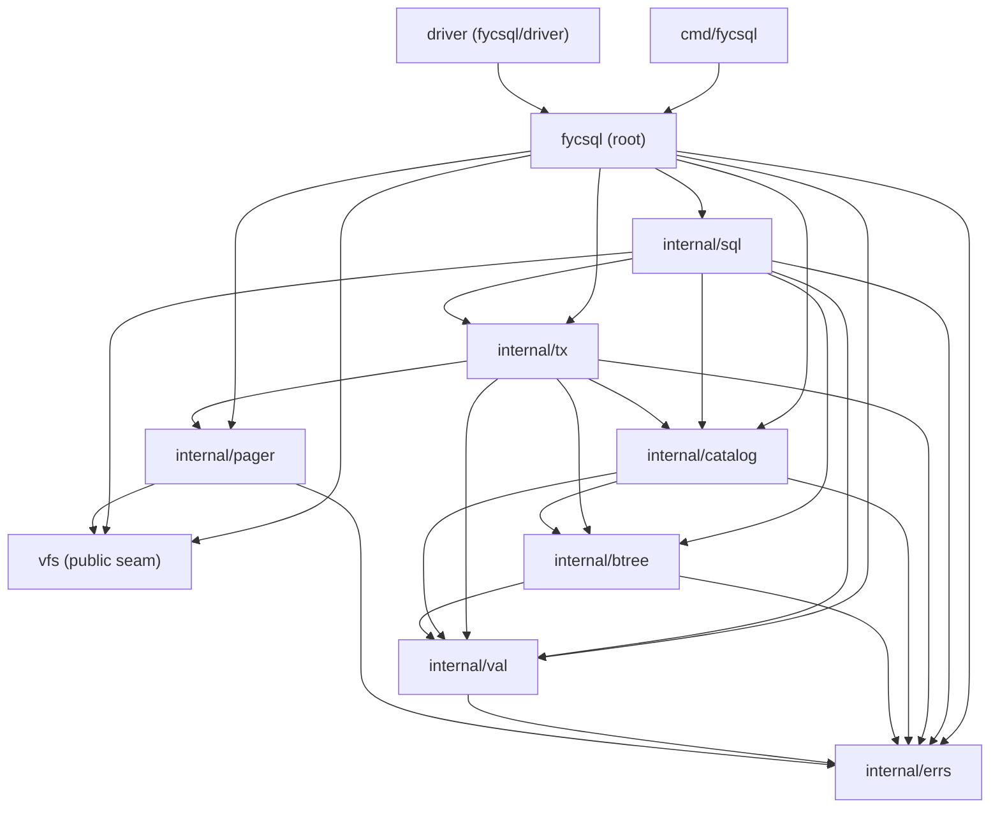

# fycsql v1 Module Seams, Interfaces, and M1–M6 Behavioral Contracts

This specification defines the **deep-module architecture**, **seam placement**, **Go `interface` restraint**, **acyclic dependency discipline**, and **master resource ownership & verification contracts** for **fycsql v1**, linking to the detailed per-milestone contract specifications for **M1–M6**.

Use this document together with [v1-architecture-handoff.md](./v1-architecture-handoff.md), [v1-invariants.md](./v1-invariants.md), [GLOSSARY.md](../../GLOSSARY.md), and [ADR-0001](../adr/0001-mvcc-occ-snapshot-isolation.md)–[ADR-0010](../adr/0010-page1-header-versioning-stats-cli-and-package-layout.md) as the implementation contract before writing production code.

---

## 1. Design Principles & Vocabulary

This contract uses the `codebase-design` vocabulary strictly:

- **Module**: A cohesive Go package (or public facade) exposing one narrow **Interface** over a rich **Implementation**.
- **Interface**: Everything a caller or test must know to use a module safely — types, methods, invariants, call-ordering rules, error modes, resource ownership, and performance guarantees (not merely Go `interface` syntax).
- **Seam**: The exact location where an interface lives and behavior can vary without editing callers.
- **Adapter**: A concrete implementation satisfying an interface at a seam.
- **Depth / Leverage / Locality**: Deep modules hide tightly coupled machinery behind small interfaces so invariants, fixes, and tests concentrate in one place rather than leaking across callers.

Four rules govern every package below:

1. **Deep Modules over Pass-Through Layers**: Tightly coupled subsystems (e.g., Buffer Pool + WAL + Frame Index + SnapshotRegistry + Freelist + Checkpoint + Recovery) stay inside one deep module (`internal/pager`) rather than splitting into shallow packages that leak cross-layer invariants.
2. **Seam Discipline (No Interface-Per-Struct)**: *"One adapter means a hypothetical seam; two adapters mean a real one."* Go `interface` types are introduced only where ≥ 2 real adapters exist (production + test or polymorphism). Single-implementation internals remain concrete structs.
3. **Explicit Resource Ownership & Lifecycle**: Every file descriptor, process lock, slab, pin, WAL generation reference, snapshot, memory budget, cursor, and temporary spill file has exactly one owner and a deterministic release contract across normal, timeout, cancellation, and Fail-Stop paths.
4. **The Interface Is the Test Surface**: Behavioral verification and milestone acceptance cases cross the same module interface as production callers (*replace, don't layer*), asserting observable outcomes and `INV-*` invariants rather than inspecting private struct fields.

---

## 2. Acyclic Package DAG & Circular Dependency Prevention

### 2.1 Strict Package Dependency Graph



> **Note on leaf packages**: `internal/errs` is strictly stdlib-only. `internal/val` depends only on `internal/errs` and stdlib so `NewReal` and checked arithmetic return canonical `errs.Err*` sentinels directly. `internal/pager` depends only on `vfs` and `internal/errs` (zero dependency on SQL value types).

### 2.2 Resolution of the Seven Circular Dependency Risks

| Potential Cycle | Root Cause | Structural Break |
| :--- | :--- | :--- |
| **`fycsql` ↔ `internal/*`** | Sentinel errors (`ErrConflict`, `ErrCorruption`, `ErrCommitIndeterminate`, etc.) and 5-type scalar `Value` are needed across every layer, but internal packages cannot import root `fycsql`. | Define canonical sentinels and internal error metadata in zero-dependency `internal/errs`, and the 5-type scalar representation in `internal/val` (`val → errs`). Root `fycsql` re-exports the exact sentinel variables (`var ErrConflict = errs.ErrConflict`) and wraps/exposes public `*fycsql.Error` and `fycsql.Value` at the root seam without leaking `internal/` types into public godoc. |
| **`vfs` ↔ `internal/errs`** | `vfs` is a public package (`github.com/fangyuchen86/fycsql/vfs`) whose callers may supply custom `vfs.FS` adapters; it cannot depend on `internal/*`. | `vfs` depends strictly on Go stdlib. It uses `os.ErrNotExist` / `os.ErrExist` and defines only minimal seam sentinels (e.g. `vfs.ErrLocked`). `internal/pager` maps `vfs.ErrLocked → errs.ErrDatabaseLocked` and I/O failures → `errs.ErrIO` (wrapping the cause). |
| **`internal/btree` ↔ `internal/pager`** | `btree` reads/mutates/allocates pages; `pager` validates the 16-byte common page header CRC32C, initializes empty Page 2 during DB bootstrap, and manages Freelist pages. | `pager` owns Page 1, the 16-byte Page 2+ common header constants/CRC sealing, empty Leaf Page 2 initialization on DB creation, and Freelist pages — and **never imports `btree`**. `btree` defines `PageReader`/`PageWriter` using Go builtin types (`uint32`, `uint8`, `[]byte`, `uint64`) and **never imports `pager`**. Zero-allocation adapters bridging `*pager.Snapshot` and `*pager.MemberStage` to `btree.PageReader`/`PageWriter` live in `internal/tx` (and root `fycsql` for `catalog.Open` bootstrap) with mandatory compile-time interface assertions (`var _ btree.PageReader = ...`). |
| **`internal/btree` ↔ `internal/catalog`** | `_fycsql_catalog` is stored in a B+Tree (`catalog → btree`), while whole-DB `Verify()` must decode logical rows with `Catalog` metadata (`AddDefault`, tombstones, indexes) and check page conservation. | `btree` exposes single-tree structural verification and page-set accounting (`VerifyTree`) with zero catalog awareness. Whole-DB `Verify()` lives above both packages in `internal/tx`. |
| **`internal/tx` ↔ `internal/catalog`** | `tx` applies DDL, bumps `SchemaVersion`, and persists sequence high-water marks inside the Commit Gate; DDL execution also mutates the transaction's RYOW schema view. | Strict one-way `tx → catalog`. `catalog` has zero knowledge of transactions: `*catalog.Schema` is immutable, and DDL methods are pure transforms returning a cloned private `*Schema` + `[]CatalogOp` (using provisional tx-local IDs until Commit Gate materialization). `tx` owns private DDL overlays and drives `catalog` during commit. |
| **`internal/tx` ↔ `internal/pager`** | Group Commit requires FIFO logical validation, per-member rollback, pre-append cancellation rebuild, and atomic logical+physical publication (ADR-0001) alongside physical WAL batching and Checkpoint serialization (ADR-0004). | Strict one-way `tx → pager`. `pager` splits physical staging (`WriteSession`/`MemberStage`), durable append (`AppendAndSync`), and visibility publication (`Publish`) so `tx.CommitGate` owns the single atomic cancellation-vs-append transition and coordinates Schema, allocator, conflict history, and WAL publication atomically. |
| **`fycsql` ↔ `driver`** | `fycsql/driver` wraps `fycsql.NewConnector`, while root `fycsql` must not trigger global `sql.Register` in `init()` (ADR-0007). | Strict one-way `driver → fycsql`. Root `fycsql` imports only the pure stdlib interface package `database/sql/driver` to expose `NewConnector`/`*Connector`; `fycsql/driver` imports `database/sql` and root `fycsql` solely for opt-in `init()` registration (`driver.DriverContext.OpenConnector`) and strict DSN parsing. |

---

## 3. Go `interface` Restraint Audit

### 3.1 Justified Go `interface` Types (4 Groups Total)

| Go `interface` | Package | Real Adapters (≥ 2) | Justification |
| :--- | :--- | :--- | :--- |
| `vfs.FS`, `vfs.File` | `vfs` | `OSFS` (Unix/Windows), `MemFS`, `CrashFS`, `ErrorFS` (+ custom caller FS) | OS portability, atomic non-clobbering publication, isolated `:memory:`, deterministic 4-mode crash/error fault injection, and separate writable `tempFS` for read-only DB spills. |
| `btree.PageReader`, `btree.PageWriter` | `internal/btree` | `snapshotPageReader` (wrapping `*pager.Snapshot`), `stagePageWriter` (wrapping `*pager.MemberStage`), `memPageStore` (M3 standalone & allocation-failure test store) | Breaks `btree → pager` dependency with zero closure allocations (`pinToken uint64`) and enables direct M3 testing of page-size boundaries, overflow/sibling/root allocation failures, and malformed-slot corruption. |
| `operator` (unexported) | `internal/sql` | ~15 physical Volcano operators (`tableScan`, `indexScan`, `filter`, `project`, `hashJoin`, `sortMergeJoin`, `indexNLJ`, `externalSort`, `topN`, `hashAgg`, `sortAgg`, …) | Core Volcano pull-pipeline polymorphism; strictly internal to `internal/sql`. |
| Go stdlib interfaces | `fycsql`, `driver` | `database/sql/driver.*` (incl. `DriverContext`), `io.Closer`, `io.Writer`, `error` (`Unwrap() []error`) | Standard library interoperability and bounded streaming contracts. |

### 3.2 Concrete Structs (No Go `interface` Abstraction Allowed)

- **`internal/pager`**: `Pager`, `Snapshot`, `PagePin`, `WriteSession`, `MemberStage`, `DurableBatch`, `BufferPool`, `WAL`, `FrameIndex`, `SnapshotRegistry`, `Freelist`, `Checkpointer`. All fault injection happens at the `vfs.FS` seam.
- **`internal/catalog`**: `Manager`, `Schema`, `TableDef`, `IndexDef`, `ColumnDef`, `SeqAllocator`. Pure in-process metadata over `btree.PageReader`/`PageWriter`.
- **`internal/tx`**: `Manager`, `Tx`, `StatementDelta`, `WriteSet`, `RowIter`, `CommitGate`, `ConflictHistory`. Concurrency invariants must be verified against the real implementation under `-race` and `testing/synctest`.
- **`internal/sql`**: `Engine`, `PreparedStmt`, `RowStream`, `Lexer`, `Parser`, `Binder`, `Planner`, `PlanCache`, `ExternalSorter`. Deterministic in-process compilation and execution over `tx.Manager` and `vfs.FS`.
- **`fycsql` (root)**: `DB`, `Conn`, `Tx`, `Stmt`, `Rows`, `Result`, `Connector`, `Error`. Callers define narrow consumer-side interfaces if they need mocking in application code.

---

## 4. Shared Leaf Contracts (`internal/errs`, `internal/val`)

### 4.1 `internal/errs`

- **Sentinels**: Defines the single canonical instance of every v1 sentinel error from [v1-architecture-handoff.md §4](./v1-architecture-handoff.md#4-default-configuration--sentinel-error-catalog):
  - Concurrency/Tx: `ErrConflict`, `ErrSchemaChanged`, `ErrTxTooLarge`, `ErrTxDone`, `ErrReadOnly`
  - SQL/Data: `ErrSyntax`, `ErrConstraint`, `ErrUniqueViolation`, `ErrNotNullViolation`, `ErrPrimaryKeyViolation`, `ErrTypeMismatch`, `ErrOverflow`, `ErrDivisionByZero`, `ErrInvalidFloat`, `ErrNotFound`, `ErrNoRows`, `ErrNoLastInsertId`
  - Storage/Lifecycle: `ErrDatabaseLocked`, `ErrDatabaseClosed`, `ErrCloseTimeout`, `ErrUnsupportedVersion`, `ErrCorruption`, `ErrIO`, `ErrFailStop`, `ErrCommitIndeterminate`
  - Internal coordination sentinel (never exposed publicly): `ErrBatchFull` (signals `tx.CommitGate` to flush earlier staged batch members and retry the current member alone in the next batch).
- **Structured Error Payload**: `Error{Code, Op, Message, Table, Constraint, Line, Col, Sentinels, Cause}` implementing `Unwrap() []error` so `errors.Is` matches both category (`ErrConstraint`) and specific sub-sentinel (`ErrUniqueViolation`), plus underlying `Cause` (e.g., OS I/O error on `ErrIO` or `ErrCommitIndeterminate`).
- **Retry Classification**: `IsRetryable(err) bool` returns `true` **only** for `ErrConflict` and `ErrSchemaChanged`. It MUST return `false` for `ErrCommitIndeterminate`, `ErrFailStop`, `ErrTxTooLarge`, and all constraint/syntax/I/O errors.

### 4.2 `internal/val`

- **Dependencies**: `internal/errs` and Go stdlib only.
- **Strict 5-Type Value**: `Type` enum `{TypeNull, TypeInteger, TypeReal, TypeText, TypeBlob, TypeBoolean}` and compact value struct (`Type`, `Int64`, `Float64`, `Bool`, `Bytes []byte` / `Str string`).
- **Invariants (`INV-CAT-01`)**:
  - `NewReal(f float64)` rejects `math.IsNaN(f)` and `math.IsInf(f, 0)` with `errs.ErrInvalidFloat`; normalizes `-0.0` to `+0.0` at encoding/comparison boundaries.
  - Only implicit numeric widening is `INTEGER → REAL`; checked `int64` arithmetic returns `errs.ErrOverflow`; division/modulo by zero returns `errs.ErrDivisionByZero`.
  - Strict binary collation for `TEXT`/`BLOB`; SQL three-valued logic (`True`, `False`, `Unknown`) for comparisons and predicates.

---

## 5. Per-Milestone Module Contracts (M1–M6)

Each milestone's detailed interface surface, behavioral invariants, error modes, resource ownership, and verification surface lives in its dedicated contract document:

| Milestone | Module(s) | Contract Document | Core Focus |
| :--- | :--- | :--- | :--- |
| **M1** | `vfs` | [m1-vfs.md](./contracts/m1-vfs.md) | Positional I/O, `PublishExclusive` atomic non-clobbering creation, exclusive locking (`OSFS`/`MemFS`), configurable 4-mode `CrashFS`, short-write & `OnIndex(k)` `ErrorFS` |
| **M2** | `internal/pager` | [m2-pager.md](./contracts/m2-pager.md) | Locked bootstrap & torn Page 1 recovery, immutable `noscan` Buffer Pool, WAL/FrameIndex, generation lifetimes, Freelist, 4-step Checkpoint, complete Durability Barrier Failure Table & Fail-Stop |
| **M3** | `internal/btree` | [m3-btree.md](./contracts/m3-btree.md) | Zero-alloc `PageReader`/`PageWriter` seams, 16B slotted page (incl. 64KiB `FreeEnd=0`), memcomparable key & row codecs, bounded overflow streaming, stable roots, `VerifyTree` |
| **M4** | `internal/catalog`, `internal/tx` | [m4-catalog-and-tx.md](./contracts/m4-catalog-and-tx.md) | Page 2 `_fycsql_catalog`, `PhysicalSlotCount` metadata-only `ALTER`, provisional private DDL IDs, atomic `Begin` + OCC history protection, unified `StatementDelta`/`WriteSet` (64MB), single-cutover FIFO `CommitGate`, whole-DB `Verify` |
| **M5** | `internal/sql` | [m5-sql.md](./contracts/m5-sql.md) | Lexer/Parser, strict 5-type Binder & SQL dialect rules, snapshot-local plan cache, Rule-Based Planner, Volcano Executor, bounded streaming `WorkMem` External Merge-Sort over separate `tempFS`, zero-side-effect `EXPLAIN` |
| **M6** | `fycsql`, `driver`, `cmd/fycsql` | [m6-api-driver-cli.md](./contracts/m6-api-driver-cli.md) | Native Go API (`CommitContext`, `Stats`, `WarningHook`), unified shutdown sequence, `driver.DriverContext.OpenConnector` & `io.EOF` preservation, no-replay `ErrCommitIndeterminate`, pure-stdlib CLI |

---

## 6. Master Resource Ownership & Lock Hierarchy Summary

### 6.1 Canonical Global Lock Hierarchy (`INV-TX-05`, `ADR-0001`)

All locks across `fycsql` strictly obey this single acyclic partial order:

```text
CommitGate (tx)  ──►  WriteSerializeMu (pager WriteSession / Checkpoint)  ──►  TxRegistry (tx)  ──►  SnapshotRegistry (pager)  ──►  WAL/BufferPool (FrameIndex, BufferPool Shards)
```

- **Read-only `Begin` / `PinPage`**: acquires only `SnapshotRegistry` → `WAL/BufferPool`; never acquires `CommitGate`, `WriteSerializeMu`, or `TxRegistry`.
- **Read-write `Begin`**: acquires `TxRegistry` → `SnapshotRegistry` (atomically binding `snapTS` and registering the OCC conflict-history watermark against publication and pruning).
- **Commit publication**: holds `CommitGate` → `WriteSerializeMu` → `TxRegistry` → `SnapshotRegistry` → `WAL/BufferPool`.
- **Checkpoint Step 4**: acquires `WriteSerializeMu` → `SnapshotRegistry` to verify full backfill and check old WAL generation atomic refcounts (`genRefCount`). Under `CheckpointPassive`, if `genRefCount > 0`, it **immediately retains the WAL, releases locks, and returns** without stalling writers. Under `CheckpointRestart` and `CheckpointTruncate`, it switches future reader admission to `<db>` and **releases `SnapshotRegistry`** before waiting for `genRefCount == 0`. Completing readers only touch `BufferPool` shard locks (never `WriteSerializeMu` or `SnapshotRegistry`) and decrement the atomic counter, guaranteeing deadlock-free retirement.
- Cached Buffer Pool frames are immutable once published, so readers hold ref-counted `PagePin`s with **zero `PageLatch`es**. Transactions hold zero row or page write locks during execution.

### 6.2 Resource Ownership Matrix

| Resource | Owner | Acquired At | Released At | Failure / Timeout / Fail-Stop Rule |
| :--- | :--- | :--- | :--- | :--- |
| `<db>` & `<db>-wal` FDs + Process Lock | `*pager.Pager` | `pager.Open` (locked before byte inspection) | Single pager finalizer **after** all physical reads, commits, and checkpoints exit | Partial `Open` unwinds in reverse order. On `CloseTimeout` or `FailStop`, preserve `<db>-wal` and retain FDs + lock until physical ops exit. Read-only opens never checkpoint or delete `<db>-wal`. |
| Buffer Pool `noscan` Slabs | `*pager.Pager` | `pager.Open` | `Pager.Close` after drain | Immutable once published; `PinnedPages == 0` on idle/close. |
| `PagePin` / `pinToken` | Active reader (`btree.Cursor` / `Get` / `Verify`) | `Snapshot.PinPage` | Single-release idempotent `Unpin` before `Snapshot.Release()` | `btree.Cursor` holds ≤ 1 leaf pin (plus ≤ 1 overflow page during `StreamValue`). |
| WAL Generation Read Ref | `*pager.Pager` (borrowed per read) | `PinPage` under `SnapshotRegistry` | Atomic decrement after `ReadAt` + cache fill finish | Checkpoint Step 4 releases `SnapshotRegistry` while waiting for old gen atomic refcount == 0. |
| `*pager.Snapshot` | `*tx.Tx` (or `Verify`) | `tx.Begin` / `AcquireSnapshot` | `Tx.Commit` / `Tx.Rollback` (idempotent) | Caps Checkpoint watermark at `minActiveSnapshotTS`; triggers `WarningHook` (outside locks) past `WALWarnWatermark`. |
| Physical Batch Staging Buffers | `tx.CommitGate` (`*pager.WriteSession`) | `pager.BeginWrite` | `DiscardMember` / `RollbackTo` / `WriteSession.Close` | Pre-allocation byte reservation; `ErrBatchFull` rolls over batch, lone-member overflow returns `ErrTxTooLarge` before append. |
| Logical `WriteSet` + `StatementDelta` | `*tx.Tx` | First write / `BeginStatement` | Reservation transfer on `CommitStatement`; release on `DiscardStatement` / `Commit` / `Rollback` | Unified 64MB pre-allocation budget (`INV-TX-06`); overflow leaves prior `WriteSet`, indexes, and private schema intact. |
| OCC Conflict History | `*tx.Manager` | Commit Gate publication (under `TxRegistry`) | Pruned as `minActiveRWWriterSnapTS` advances | Protected atomically against concurrent `Begin(rw)` by `TxRegistry`. |
| Immutable `*catalog.Schema` | `*catalog.Manager` (shared) or `*tx.Tx` (private) | Commit Gate publish / private DDL clone | GC after old readers/plans release | Never mutated in place; private DDL uses provisional IDs and never enters shared cache or plan cache. |
| Temp Spill Files (`tempFS`) | `*sql.RowStream` (and `Query` prior to stream return) | First temporary run creation on `tempFS` | Exhaustion, error, cancellation, or `RowStream.Close` | Written to separate writable `tempFS`; per-stream cleanup leaves zero files when `tempFS.Remove` succeeds. Persistent `Remove` failures are reported to the caller, and external/OS temp-dir cleanup retains responsibility for the unremoved path. |
| Public Handles (`DB`/`Conn`/`Tx`/`Rows`) | Application caller (`DB` tracks for close cancel) | `Open`/`Conn`/`BeginTx`/`Query` | `Close`/`Commit`/`Rollback` (all autocommit queries — `DB`, `Conn`, `Stmt`, `driver` — own & release their implicit read-only `Tx`, including on setup error before `Rows` is returned) | `CloseContext` cuts off admission once, cancels logical handles on timeout, releases iterators/pins before snapshots; repeated `Close` is idempotent. |

---

## 7. Verification Surface Matrix (M1–M6)

| Milestone | Primary Test Seam | Invariants Enforced | Acceptance Cases Covered ([handoff §5](./v1-architecture-handoff.md#required-milestone-acceptance-cases)) |
| :--- | :--- | :--- | :--- |
| [**M1**](./contracts/m1-vfs.md) | `vfs.FS`, `vfs.File`, concrete `CrashFS`/`ErrorFS` control API | `INV-WAL-06`, `INV-API-02` | `OSFS`/`MemFS` parity, `PublishExclusive` non-clobbering creation, same-process + child-process cross-process OS locking, `CrashFS` 4-mode image enumeration (incl. create/`SyncDir`), `ErrorFS` short writes & read `EIO`. |
| [**M2**](./contracts/m2-pager.md) | `pager.Pager` + `CrashFS`/`ErrorFS` | `INV-WAL-01`–`06`, `INV-STR-01`–`02`, `INV-TX-05` | Delayed opener paused after temp-file sync & before `PublishExclusive`, orphan-WAL retry race against concurrent creator, clean closed DB read-only open with absent WAL, WAL stat/read `EIO`, A/B marker short-write (neither live, A&B indeterminate, queued C `ErrFailStop`, 2x reopen legal prefix), torn Page 1 + invalid candidate WAL Page 1 (`ErrCorruption`) + unsupported candidate WAL Page 1 (`ErrUnsupportedVersion`) + unsupported 32B WAL header, every Durability Barrier failure (incl. pre-frame new-WAL header sync + `SyncDir`), `CloseTimeout` lock hold, paused cache-fill + concurrent snapshot admission + WAL generation retirement, `CheckpointPassive` non-blocking under active reader & reuse when drained, Page 2 Freelist audit exclusion. |
| [**M3**](./contracts/m3-btree.md) | `btree` codecs, tree ops, `Cursor`, `VerifyTree` + `memPageStore` | `INV-STR-03`, `INV-CAT-02` | All page sizes (4K–64K incl. `FreeEnd=0`), internal underflow with long separator, overflow/sibling/root allocation failure + explicit rollback/discard (repeated against real `MemberStage` in M4), layered corruption rejection (malformed cells/overflows at tree seam, truncated envelopes at row codec, separator routing/disjoint ranges in `VerifyTree`), bounded `StreamValue` on oversized overflow chains. |
| [**M4**](./contracts/m4-catalog-and-tx.md) | `tx.Manager`, `catalog.Manager` | `INV-TX-01`–`06`, `INV-STR-04`–`05`, `INV-CAT-03`–`04` | Same-leaf disjoint updates, unique-prefix collisions, delete/reinsert, multi-row intra-statement duplicate + half-way `stmtCtx` cancellation in `StageCreateIndex`, `Begin` vs commit/prune race, concurrent `CREATE TABLE` + private-table insert + rollback + failed middle batch member with allocator rollback, single-linearization withdrawal vs seal race, `A` withdrawn before append with dependent `B`, `B` provisional conflict wakeup (`ErrFailStop`) when `A` append fails, concurrent DML vs index build + reopen bijection check, old Snapshot across `DROP` + page reuse + partial backfill, sequence high-water recovery after max-ID delete, 1,024th/1,025th `PhysicalSlotCount` & zero-page-touch `ALTER TABLE`. |
| [**M5**](./contracts/m5-sql.md) | `sql.Engine`, `PreparedStmt`, `RowStream` + `ErrorFS`-wrapped `tempFS` | `INV-QRY-01`–`02`, `INV-CAT-01`–`02` | Coupled old-snapshot prepared lookup probing **both** split subtrees → root collapse → freed child PageID reuse; scan vs index equivalence across private `ALTER`/rollback, absent slots vs explicit `NULL`, 900B keys, wide composite directions, explicit & default `NULL` ordering, case-sensitive `LIKE`, identifier quoting, mixed placeholder rejection, zero-side-effect `EXPLAIN` (incl. DML), row > `WorkMem` streaming spill, two `ORDER BY` keys > `WorkMem` with long common prefix, oversized duplicate-group join + concurrent spilling streams + cancel/read-only cleanup (and persistent `Remove` error reporting). |
| [**M6**](./contracts/m6-api-driver-cli.md) | Root `fycsql`, `database/sql` + `fycsql/driver`, `cmd/fycsql` | `INV-API-01`–`02`, `INV-WAL-05` | Execution-attempt count `== 1` on `ErrCommitIndeterminate` across native, driver, and CLI (plus deterministic CLI fault trigger); separate successful post-append cancellation case; both `sql.Open("fycsql", dsn)` (`OpenConnector`) and `sql.OpenDB(NewConnector)` with two concurrent checked-out connections + isolated `:memory:` pools; `driver.Rows.Next` raw `io.EOF`; autocommit implicit-tx cleanup across `DB`/`Conn`/`Stmt`/`driver` (incl. pre-`Rows` errors); CLI `Conn.Close()` before `DB.CloseContext` + EOF/`.quit` rollback & `.tables`/`.schema`; `go list -deps` stdlib-only gate. |
